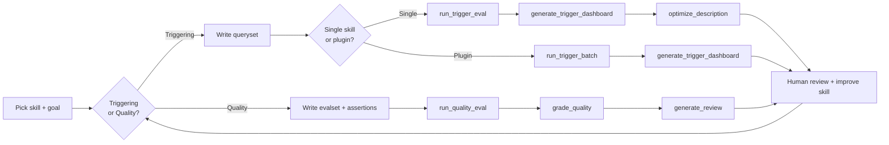

# Evaluate a skill with the Copilot SDK

This skill measures whether another skill actually works by running it in
isolated GitHub Copilot SDK sessions. It follows the evaluation methodology
documented at
[agentskills.io](https://agentskills.io/skill-creation/evaluating-skills), and
runs anywhere the Copilot CLI is installed.

There are two independent questions, and you can answer either or both:

1. **Triggering** — does the skill's `description` cause the agent to invoke it
   for relevant prompts, and stay quiet for irrelevant ones? This is decided
   entirely by the `name` + `description` the agent sees at startup.
2. **Output quality** — when the skill *is* used, does it produce meaningfully
   better results than the same agent with no skill? This is decided by the
   skill's body, bundled scripts, and references.

Keep them separate: a skill can trigger perfectly but give mediocre output, or
give great output but never trigger. Different fixes, different evals.

## The core loop

**Run → review → improve → repeat**, with a human in the loop. Don't act on the
numbers alone — the benchmark tells you *what* changed; the actual outputs and
transcripts tell you *why*. The scripts only ever read the skill and write
results elsewhere: you apply every description and body edit yourself, so a bad
automated suggestion can't corrupt a real skill.



## Prerequisites (check once)

The scripts need the Copilot SDK and a logged-in Copilot CLI. Verify before the
first run:

```bash
python -c "import copilot; print('SDK', copilot.__version__ if hasattr(copilot,'__version__') else 'ok')"
```

If that errors, install with `pip install "github-copilot-sdk>=1.0.0"` and then
run `python -m copilot download-runtime` to cache the CLI binary. Make sure you
are signed in to GitHub Copilot. The scripts authenticate as the logged-in user
automatically — no token wrangling.

All scripts live in the `scripts/` folder next to this file. In the commands
below, `$SCRIPTS` stands for that folder's path. Running a script by its full
path is enough — each one adds its own directory to the import path, so the
shared `eval_harness.py` resolves without any install step.

**Choosing a model.** Runs default to `claude-haiku-4.5` — fast and cheap, which
matters because evals fan out into many sessions. If the user names a model,
resolve it to an id first — `python $SCRIPTS/list_models.py --resolve "opus 4.8"`
prints the id, or, when the name is ambiguous or unknown, the models available on
this account for the user to pick from. Pass the chosen id to any eval script via
`--model` (or set `COPILOT_EVAL_MODEL` to change the default globally).
Availability is plan-dependent, so the live list is the truth;
[references/models.md](references/models.md) is a snapshot. For *triggering* evals,
match the model your users actually run. For *quality grading and the
description-improvement judge*, a stronger model (`claude-sonnet-4.6`,
`claude-opus-4.8`) gives sharper verdicts — pass it via `--model`.

**Where results go.** Every script writes under a results root: whatever you pass
as `--out DIR`, or by default `<skill-name>_eval_results/` at the repo root, keyed
to the skill under test so evaluating several skills never collides. Artifacts are
filed by eval type — `triggering/` (trigger results, description optimization) and
`quality/` (the with/without workspace of `iteration-N/...`, benchmark, and review
page). For the quality sequence, pass the same skill (or `--out`) through
`run_quality_eval` → `grade_quality` → `generate_review` so they share one location.

---

## Path A — Triggering evaluation

Use this when the question is "does it fire at the right times?" Full details on
queryset design and the optimization loop are in
[references/triggering-evals.md](references/triggering-evals.md) — **read it
before writing queries**, because query quality is what makes or breaks this eval.

### A.1 — Write a queryset

Realistic prompts labeled with whether the skill should trigger. The canonical
format is an object with a `skill_name` and an `evals` array:

```json
{
  "skill_name": "my-skill",
  "evals": [
    {"id": 1, "query": "...", "should_trigger": true, "rationale": "..."},
    {"id": 2, "query": "...", "should_trigger": false, "rationale": "..."}
  ]
}
```

A flat JSON list of `{"query", "should_trigger"}` objects is also accepted as
shorthand. Aim for ~20 queries: 8-10 should-trigger, 8-10 should-not, weighted
toward *near-misses* (queries that share keywords but need something else). See
the schema in [references/schemas.md](references/schemas.md) and the worked
example in [assets/trigger_queryset.example.json](assets/trigger_queryset.example.json).

### A.2 — Single-skill measurement

Use this when evaluating one skill in isolation or against its siblings.

```bash
python $SCRIPTS/run_trigger_eval.py \
  --skill-path PATH/TO/skill \
  --queryset queryset.json \
  --runs 3
```

Each query runs 3× (triggering is nondeterministic) and passes if its trigger
rate clears the threshold (default 0.5); each run stops the instant the outcome
is decided (the skill is invoked, or the agent starts answering without it)
rather than waiting for the full response, so this stays fast. You get per-query
pass/fail plus precision/recall/accuracy, written to
`triggering/trigger_results.json` under the results root. By default the skill is
tested in isolation; add `--in-context` to include its sibling skills as
competition for a harder, more realistic signal.

To generate a visual dashboard after the eval:

```bash
python $SCRIPTS/generate_trigger_dashboard.py --skill-path PATH/TO/skill
```

### A.3 — Plugin / multi-skill measurement

Use this when evaluating an entire plugin where multiple skills compete for the
same queries. Each skill needs a queryset file named `<skill-name>.json` in a
shared querysets directory.

```bash
python $SCRIPTS/run_trigger_batch.py \
  --plugin-path PATH/TO/plugin \
  --querysets-dir PATH/TO/querysets/ \
  --runs 3 --model claude-sonnet-4.6 \
  --out RESULTS/
```

This discovers all skills in the plugin directory (subdirectories containing a
`SKILL.md`), matches each to its queryset, and runs all evals in-context (every
skill loaded as competition). Per-skill results go to
`RESULTS/<skill>/triggering/trigger_results.json`, and a combined dashboard is
generated at `RESULTS/trigger_dashboard.html`.

The dashboard shows each skill's accuracy, F1, precision, and recall side by
side — making it easy to spot which skills over-trigger (low precision) or
under-trigger (low recall) when competing with their siblings.

To regenerate the dashboard after updating individual skill results (e.g. after
re-running one skill with an improved description):

```bash
python $SCRIPTS/generate_trigger_dashboard.py --out RESULTS/
```

### A.4 — Optimize the description (single-skill only)

```bash
python $SCRIPTS/optimize_description.py \
  --skill-path PATH/TO/skill \
  --queryset queryset.json \
  --runs 3 --max-iterations 5
```

This splits the queryset (60% train / 40% validation), evaluates, asks a judge
model to propose a better description from the *train* failures, re-evaluates,
and repeats — selecting the winner by *validation* score to avoid overfitting.
It **does not edit the SKILL.md**; it writes `triggering/optimization.json` and an
`optimization.html` report, and prints `best_description` for you to review and
apply by hand.

For plugin evals, optimize individual skills one at a time, then re-run the
batch (A.3) to verify the ecosystem effect.

### A.5 — Apply and verify

Update the `description` in the skill's frontmatter (keep it under 1024
characters), then re-run step A.2 or A.3 on a few *fresh* queries to confirm it
generalizes.

---

## Path B — Output-quality evaluation

Use this when the question is "when it runs, is the output good?" Full guidance
on assertions, grading, and reading benchmarks is in
[references/quality-evals.md](references/quality-evals.md).

**1. Write an evalset.** 2-3 realistic test prompts to start (expand later),
each with input files if needed. Don't write assertions yet — run first, then
add assertions once you've seen what "good" looks like. Schema and example:
[references/schemas.md](references/schemas.md),
[assets/quality_evalset.example.json](assets/quality_evalset.example.json).

**2. Run with-skill vs baseline:**

```bash
python $SCRIPTS/run_quality_eval.py \
  --skill-path PATH/TO/skill \
  --evalset evalset.json \
  --iteration 1 --runs 1
```

Every prompt runs twice: once with the skill available (and nudged into use, so
you measure its instructions rather than its triggering) and once with no skill
as the baseline. Outputs, tokens, timing, and the final response are saved under
`quality/iteration-1/eval-*/` in the results root. Raise `--runs` to 3+ once
assertions are stable to get standard deviations.

**3. Add assertions**, then grade and benchmark. Put an `assertions` array on
each eval in your evalset (see quality-evals.md for what makes a good one), then:

```bash
python $SCRIPTS/grade_quality.py --skill-path PATH/TO/skill --iteration 1
```

A judge session scores each assertion PASS/FAIL with evidence (writing
`grading.json` per run), then aggregates `benchmark.json` with per-config
mean/stddev, the with-vs-without **delta**, and analyst notes that flag
non-discriminating assertions, always-failing assertions, and high-variance
evals.

**4. Review with a human — do this before you start "fixing" things:**

```bash
python $SCRIPTS/generate_review.py --skill-path PATH/TO/skill --iteration 1
```

This writes a self-contained `review.html` (open it in a browser) showing each
prompt with its with-skill and baseline outputs side by side, the grades, and a
feedback box per case. Clicking "Submit All Reviews" downloads `feedback.json`;
drop it in the iteration folder. The human catches what assertions can't —
technically-correct-but-wrong-spirit outputs, formatting, tone.

**5. Improve and repeat.** Synthesize the three signals — failed assertions,
human feedback, and execution transcripts (`run_result.json` / `transcript.md`)
— into skill edits, then rerun into `iteration-2/` and compare. Keep going until
feedback is consistently empty or gains plateau. How to turn signals into good
edits is in [references/quality-evals.md](references/quality-evals.md#iterating).

---

## Reference files

Load these as needed — don't read them all up front:

- [references/triggering-evals.md](references/triggering-evals.md) — queryset
  design (should/should-not, near-misses, realism), thresholds, the train/val
  optimization loop, and how to read the results. Read before writing queries.
- [references/quality-evals.md](references/quality-evals.md) — writing
  assertions, grading principles, baselines, interpreting the benchmark and its
  delta, pattern analysis, and turning feedback into skill edits. Read before
  writing assertions.
- [references/copilot-sdk.md](references/copilot-sdk.md) — how the harness drives
  the SDK: session config, the events it listens to, controlling skill
  availability, and extending the harness. Read when modifying the scripts,
  tuning concurrency or timeouts, or debugging a run.
- [references/schemas.md](references/schemas.md) — exact JSON shapes for the
  queryset, evalset, trigger results, grading, benchmark, and feedback files.
  Read when authoring or parsing any of these files.
- [references/models.md](references/models.md) — the model lineup (Claude,
  OpenAI, Gemini, and more) with their SDK ids, the default, and cost/speed
  notes. Read when picking a model or when a name won't resolve.
